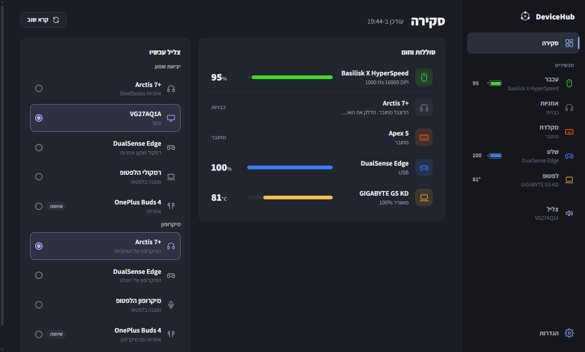
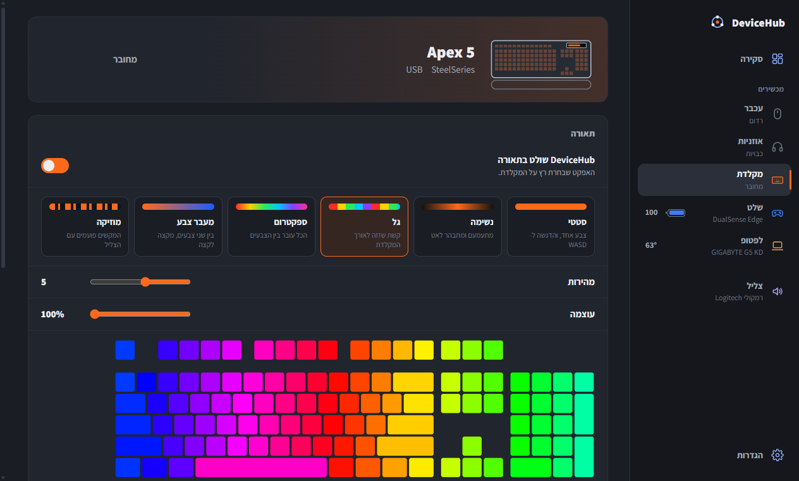
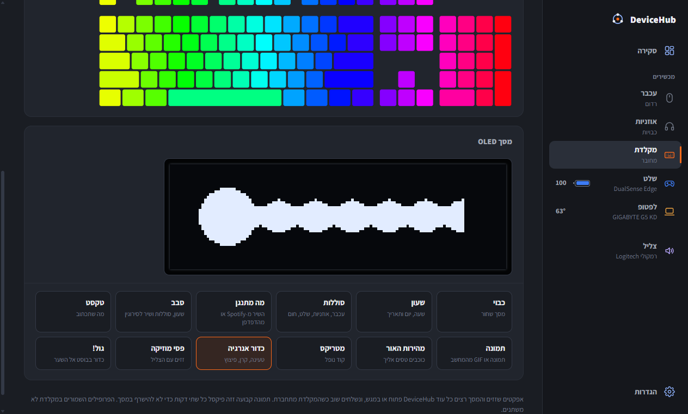
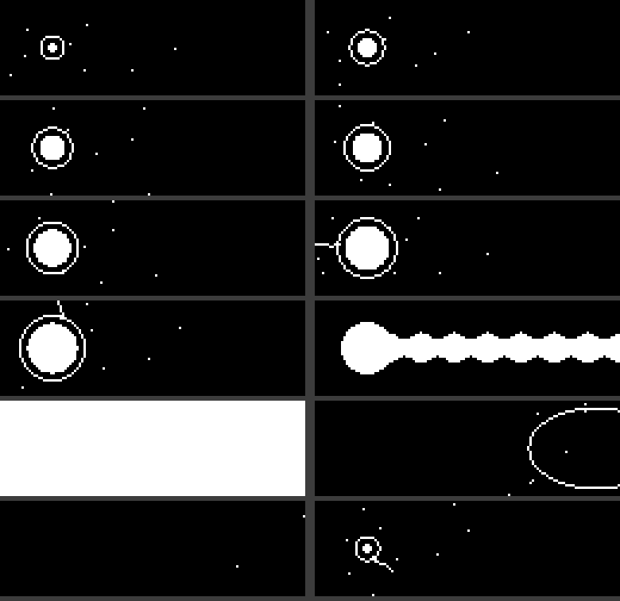

# DeviceHub

**One small control center for the devices on my desk, in place of Razer Synapse, SteelSeries GG and the rest.**




Vendor suites are heavy: background services, startup entries, overlays, telemetry, some even record the screen.
DeviceHub is one small app. It talks to each device in user mode through Windows' own HID and audio APIs:
no driver, no service. It sits in the tray only while it has something to keep running (keyboard effects, the
keyboard's screen), and starts with Windows only if you ask.

> Made by **Hananel Sabag**.

---

## What it does

| Device | Reads | Changes |
|---|---|---|
| **Razer Basilisk X HyperSpeed** (1532:0083) | Battery, polling rate, DPI, DPI stages, sleep time, low-battery warning | DPI stages and the active one, polling rate (125/500/1000 Hz), sleep time (1-15 min), low-battery warning (5-25 %). Every change is read back from the mouse. |
| **SteelSeries Arctis 7+** (1038:220E) | Battery, charging, ChatMix | Sidetone (4 levels), auto-off (never - 90 min), 10-band equalizer and SteelSeries' four presets, and your own profiles ("Games", "Music"…) that apply all three in one press. Saved in the headset. |
| **SteelSeries Apex 5** (1038:161C) | Connected | One switch hands the lighting to DeviceHub (off: the keyboard's own lighting). Fourteen effects: static with a W A S D / arrows accent, breathing, rainbow wave, spectrum, gradient, aurora, starlight, rain, fire, music (keys pulse with what the PC plays), a sound meter, CPU heat (the whole board from blue to red with the CPU's temperature), key press (the key lights and fades) and ripple (a ring spreads from the key); speed and brightness. **The OLED screen:** clock, analog clock, batteries, CPU / GPU, now playing (Spotify, a browser…), a rotation of those, your own text, your own picture or animated GIF, and animations drawn for DeviceHub: warp speed, matrix, an energy blast, a power-up, fireworks, Conway's Game of Life, a bouncing logo, music bars and a goal, plus a show that plays them all with transitions (wipe, dissolve, iris, blinds, slide). |
| **DualSense Edge** (054C:0DF2, and DualSense) | Battery, charging, USB or Bluetooth | Lightbar colour and brightness, still, breathing, rainbow or battery colour (green, yellow, red); player lights, mute-button light (USB). The moving lightbars pause while a full-screen game is in front. |
| **Laptop** (Clevo-built GIGABYTE G5 KD) | CPU and GPU temperature and load (as Task Manager counts it), both fans' duty and real RPM, memory, the laptop's battery and its draw, Windows' power mode, the last 5 minutes of both temperatures | Windows' power mode (saving, balanced, performance). Fan control stays in the maker's Control Center on purpose. |
| **Sound** | Every output and microphone, with the real device names (the Logitech speakers behind the UGREEN-90748 receiver, the monitor, the headset, the controller) | One press makes a device the default, for calls too if you want. |

| Mouse | Keyboard | Controller |
|---|---|---|
|  |  |  |
| **Keyboard screen** | **Energy blast, frame by frame** | |
|  |  | |

Things the devices forget on their own are remembered by DeviceHub (`%LOCALAPPDATA%\DeviceHub\devices.json`):
the controller's lights, the keyboard's effect and its screen are sent again whenever DeviceHub sees the device
plugged in, and the headset's sidetone, auto-off and equalizer (which it cannot report back) are shown as last set.

**In the tray.** Closing or minimizing the window leaves DeviceHub in the tray, by the clock, so effects and the screen
keep going (0.05 % CPU with the wave and the screen running). One click on the icon opens the window; the right button
opens a quick menu with every battery and the laptop's heat, and one-click changes of the sound device, the keyboard's
effect and its screen. A note comes when the mouse, headset or controller drops below 15 %, and *Start with Windows*
(one shortcut in the Startup folder) starts it there quietly. A second start opens the running one. A still picture on
the screen shifts a pixel every two minutes so it never burns in. Settings shows how DeviceHub itself is doing (how long
it has run, its CPU and memory, the frames it has sent, the last error), and `%LOCALAPPDATA%\DeviceHub\log.txt` records
every start, every exit and why, and every error.

**Why the keyboard needs DeviceHub running.** The Apex 5 has two ways to light up: the profile saved in its own memory
(what it shows when DeviceHub is off), and a direct mode that shows whatever colours a program sends, live. Moving effects
are frames, computed 20-30 times a second, so there is nothing to store; and the commands that write the keyboard's own
memory are not public (OpenRGB drives this keyboard the same live way). SteelSeries GG, Razer Synapse, iCUE and G Hub work
the same: their software effects, reactive keys and screen content all need the app running in the background.

## Safe with Easy Anti-Cheat

Rocket League runs Easy Anti-Cheat. DeviceHub gives it nothing to object to:

- No kernel driver of its own, and nothing injected anywhere. Everything is user-mode HID (`hid.dll`), Core Audio,
  Windows' media session API, and the laptop maker's own DLL (`InsydeDCHU.dll`, the one Control Center uses) for
  reading two sensor values.
- It never touches a game process.
- While the window is minimized or in the tray its page is suspended; only the keyboard engine and a device read every
  two minutes keep going.

## How each device is spoken to

Each protocol comes from an open-source project that documented it, re-implemented here and checked against the real device.

- **Razer** — 90-byte feature reports on interface 0 ([OpenRazer](https://github.com/openrazer/openrazer)). Transaction id 0x1F
  on this receiver. Classes used: 07/80 battery, 00/85 + 00/05 polling, 04/85 + 04/05 DPI, 04/86 + 04/06 DPI stages,
  07/83 + 07/03 sleep time, 07/81 + 07/01 low-battery level.
- **Arctis 7+** — output reports on the dongle's vendor collection (page FFC0, interface 3), from
  [HeadsetControl](https://github.com/Sapd/HeadsetControl): `B0` status, `39` sidetone, `A3` auto-off, `33` equalizer, then `09` to save.
  Windows' `ReadFile` keeps the report id, so HeadsetControl's `data[i]` is DeviceHub's `res[i + 1]`.
- **Apex 5** — [OpenRGB](https://github.com/CalcProgrammer1/OpenRGB)'s first-generation Apex protocol on interface 1: 643-byte feature
  report `3A` (a colour per key), `3B` back to the keyboard's own lighting. This model does not answer the newer brightness
  query (`A3`), so brightness scales the colours. Effects are computed by DeviceHub from a key map and sent 20 times a second.
  The OLED takes feature report `61` with a 128 × 40 one-bit picture, row by row ([apex-tux](https://github.com/not-jan/apex-tux)'s protocol);
  pictures are drawn with GDI+ and dithered (Floyd–Steinberg); now playing comes from Windows' media session API; the
  music effects follow the same peak meter as Windows' volume mixer (only the level is read, nothing is recorded).
- **DualSense** — the battery is in every USB input report (byte 53; 54 in Bluetooth's full report). Lights use USB output report
  `02` with only the light fields flagged valid, laid out as in Linux's `hid-playstation`.
- **Laptop** — `GetDCHU_Data_Buffer(12)`: fan tacho periods at bytes 2-3 (CPU) and 4-5 (GPU), rpm = 2156220 / period;
  duty at 16 (CPU) and 19 (GPU); temperature at 18 (CPU) and 21 (GPU), checked against `nvidia-smi`. Load from the
  performance counters Task Manager uses (`% Processor Utility`, `GPU Engine … engtype_3D`); battery draw from WMI `BatteryStatus`;
  power mode through `PowerSetActiveOverlayScheme`.
- **Key presses** — Windows' Raw Input with `RIDEV_INPUTSINK`, registered only while a key-press effect is on: a copy of each
  key-down, nothing intercepted or stored, and only presses from the Apex itself count.
- **Sound** — `IMMDeviceEnumerator` to list, `IMMNotificationClient` to hear about changes (nothing is polled), `IPolicyConfig` to set the default.

## Run it

Installed copy: `%LOCALAPPDATA%\Programs\DeviceHub\DeviceHub.exe` (Desktop and Start menu shortcuts). To build:

```powershell
dotnet build DeviceHub.slnx
dotnet test DeviceHub.slnx
dotnet publish src/DeviceHub/DeviceHub.csproj -c Release -o "$env:LOCALAPPDATA\Programs\DeviceHub"
```

From a script (handy for checking a device without the window):

```text
DeviceHub.exe --dump-json out.json [en]          read every device and sound device once
DeviceHub.exe --settings mouse out.json          a device page's settings
DeviceHub.exe --control mouse polling 1000 out.json   one change (the value is JSON), then the settings read back
DeviceHub.exe --audio-switch-test out.json       switch the default output to another device and straight back
DeviceHub.exe --screen-preview clock out.png     the keyboard screen's picture, 4× larger (clock|devices|music|text|image)
DeviceHub.exe --screen-demo energy 10 sheet.png  play an animation on the keyboard for 10 s and save its frames
DeviceHub.exe --tray                             start quietly in the tray (how Windows starts it)
```

Opening `src/DeviceHub/wwwroot/index.html` from a local web server shows the page with sample readings (`?lang=en` for English).

## Layout

```text
src/DeviceHub/
  Interop/Hid.cs          HID enumeration, feature and input/output reports
  Devices/                RazerMouse, ArctisHeadset, ApexKeyboard, DualSense, LaptopSensors,
                          DeviceReader (reads), DeviceControls (changes + what is remembered)
  Lighting/               the engine that drives the keyboard (KeyboardEffects, KeyboardLayout) and its screen
                          (OledScreen, ScreenAnimations, NowPlaying), on one background thread
  Audio/                  Core Audio interop, real device names, default switching, change notifications, sound level
  MainForm.cs             WebView2 host, the tray, the page's messages
  wwwroot/                the page: views.js draws, art.js has the device drawings, effects.js previews the lighting,
                          app.js wires, i18n.js holds both languages
tests/DeviceHub.Tests/    every protocol checked against recorded bytes, effects and screen drawing
tools/make-icon.ps1       draws app.ico
```

## Next

- Connecting the UGREEN receiver from the Sound page when it is paired but not connected.
- Per-key painting on the keyboard preview, and a lighting reaction to key presses.
- A real spectrum (loopback capture and FFT) for the music bars, instead of the level history.
