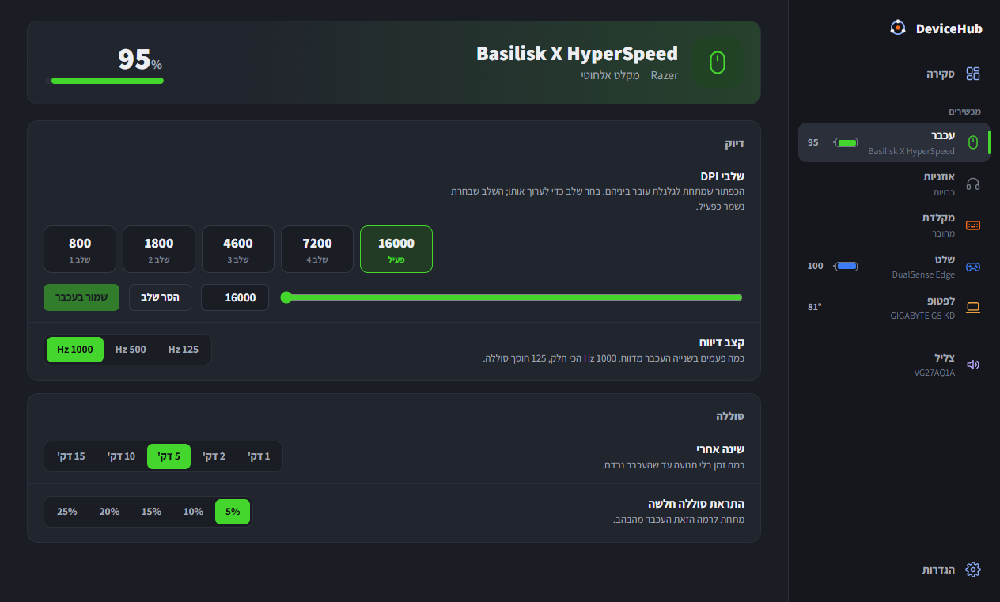
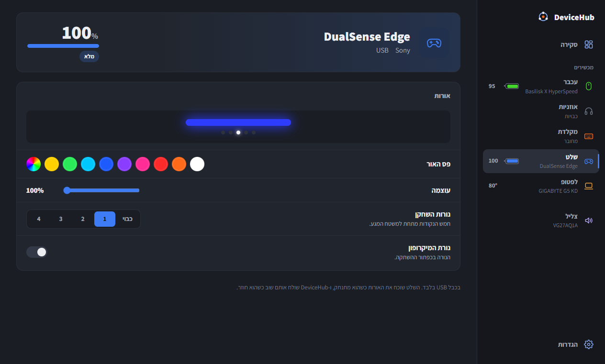

# DeviceHub

**One small control center for the devices on my desk, in place of Razer Synapse, SteelSeries GG and the rest.**


Vendor suites are heavy: background services, startup entries, overlays, telemetry, some even record the screen.
DeviceHub is a single window that starts when you open it and stops when you close it. It talks to each device in
user mode through Windows' own HID and audio APIs: no driver, no service, nothing at startup.

> Made by **Hananel Sabag**.

---

## What it does

| Device | Reads | Changes |
|---|---|---|
| **Razer Basilisk X HyperSpeed** (1532:0083) | Battery, polling rate, DPI, DPI stages, sleep time, low-battery warning | DPI stages and the active one, polling rate (125/500/1000 Hz), sleep time (1-15 min), low-battery warning (5-25 %). Every change is read back from the mouse. |
| **SteelSeries Arctis 7+** (1038:220E) | Battery, charging, ChatMix | Sidetone (4 levels), auto-off (never - 90 min), 10-band equalizer and SteelSeries' four presets. Saved in the headset. |
| **SteelSeries Apex 5** (1038:161C) | Connected | One colour on every key, an accent colour for W A S D and the arrows, brightness; or back to the keyboard's own lighting. |
| **DualSense Edge** (054C:0DF2, and DualSense) | Battery, charging, USB or Bluetooth | Lightbar colour and brightness, player lights, mute-button light (USB). |
| **Laptop** (Clevo-built GIGABYTE G5 KD) | Temperature, fan duty, the last 5 minutes of temperature | Nothing on purpose: fan control stays in the maker's Control Center. |
| **Sound** | Every output and microphone, with the real device names (the Logitech speakers behind the UGREEN-90748 receiver, the monitor, the headset, the controller) | One press makes a device the default, for calls too if you want. |

| Mouse | Keyboard | Controller |
|---|---|---|
|  |  |  |

Things the devices forget on their own are remembered by DeviceHub (`%LOCALAPPDATA%\DeviceHub\devices.json`):
the controller's lights and the keyboard's colours are sent again whenever DeviceHub sees the device plugged in,
and the headset's sidetone, auto-off and equalizer (which it cannot report back) are shown as last set.

## Safe with Easy Anti-Cheat

Rocket League runs Easy Anti-Cheat. DeviceHub gives it nothing to object to:

- No kernel driver of its own, and nothing injected anywhere. Everything is user-mode HID (`hid.dll`), Core Audio,
  and the laptop maker's own DLL (`InsydeDCHU.dll`, the one Control Center uses) for reading two sensor values.
- It never touches a game process.
- While the window is minimized it reads nothing and its page is suspended.

## How each device is spoken to

Each protocol comes from an open-source project that documented it, re-implemented here and checked against the real device.

- **Razer** — 90-byte feature reports on interface 0 ([OpenRazer](https://github.com/openrazer/openrazer)). Transaction id 0x1F
  on this receiver. Classes used: 07/80 battery, 00/85 + 00/05 polling, 04/85 + 04/05 DPI, 04/86 + 04/06 DPI stages,
  07/83 + 07/03 sleep time, 07/81 + 07/01 low-battery level.
- **Arctis 7+** — output reports on the dongle's vendor collection (page FFC0, interface 3), from
  [HeadsetControl](https://github.com/Sapd/HeadsetControl): `B0` status, `39` sidetone, `A3` auto-off, `33` equalizer, then `09` to save.
  Windows' `ReadFile` keeps the report id, so HeadsetControl's `data[i]` is DeviceHub's `res[i + 1]`.
- **Apex 5** — [OpenRGB](https://github.com/CalcProgrammer1/OpenRGB)'s first-generation Apex protocol on interface 1: 643-byte feature
  report `3A` (a colour per key), `3B` back to the keyboard's own lighting. This model does not answer the newer brightness
  query (`A3`), so brightness scales the colours.
- **DualSense** — the battery is in every USB input report (byte 53; 54 in Bluetooth's full report). Lights use USB output report
  `02` with only the light fields flagged valid, laid out as in Linux's `hid-playstation`.
- **Laptop** — `GetDCHU_Data_Buffer(12)`: fan duty at byte 16, temperature at byte 18.
- **Sound** — `IMMDeviceEnumerator` to list, `IMMNotificationClient` to hear about changes (nothing is polled), `IPolicyConfig` to set the default.

## Run it

Installed copy: `%LOCALAPPDATA%\Programs\DeviceHub\DeviceHub.exe` (Desktop and Start menu shortcuts). To build:

```powershell
dotnet build DeviceHub.slnx
dotnet test DeviceHub.slnx
dotnet publish src/DeviceHub/DeviceHub.csproj -c Release -o "$env:LOCALAPPDATA\Programs\DeviceHub"
```

From a script (handy for checking a device without the window):

```text
DeviceHub.exe --dump-json out.json [en]          read every device and sound device once
DeviceHub.exe --settings mouse out.json          a device page's settings
DeviceHub.exe --control mouse polling 1000 out.json   one change (the value is JSON), then the settings read back
DeviceHub.exe --audio-switch-test out.json       switch the default output to another device and straight back
```

Opening `src/DeviceHub/wwwroot/index.html` from a local web server shows the page with sample readings (`?lang=en` for English).

## Layout

```text
src/DeviceHub/
  Interop/Hid.cs          HID enumeration, feature and input/output reports
  Devices/                RazerMouse, ArctisHeadset, ApexKeyboard, DualSense, LaptopSensors,
                          DeviceReader (reads), DeviceControls (changes + what is remembered)
  Audio/                  Core Audio interop, real device names, default switching, change notifications
  MainForm.cs             WebView2 host and the page's messages
  wwwroot/                the page: views.js draws, app.js wires, i18n.js holds both languages
tests/DeviceHub.Tests/    every protocol checked against recorded bytes
tools/make-icon.ps1       draws app.ico
```

## Next

- A tiny tray part that starts with Windows, puts the keyboard and controller colours back after a reboot, and warns about a low battery.
- The Apex 5's OLED screen (128 × 40): battery levels or the time.
- Connecting the UGREEN receiver from the Sound page when it is paired but not connected.
